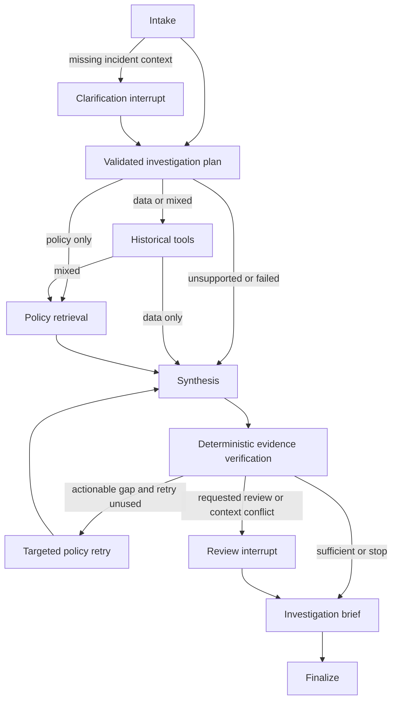

# V2 architecture

V2 is an additive module in the existing CPU-only modular monolith. V1 corpus,
SQLite incident repository, arithmetic, four tools, provider transports, grounding
checks and `/api/chat` remain reusable and independently testable.

## Modules and responsibilities

| Module | Responsibility |
|---|---|
| `investigation/models.py` | Bounded Pydantic API/brief contracts and JSON-only typed graph state |
| `investigation/planning.py` | Independent evidence requirements and model-plan validation |
| `investigation/chains.py` | LangChain prompt, runnable and Pydantic parser around the V1 provider boundary |
| `investigation/evidence.py` | Quote synthesis, deterministic numerical text/comparison, section/authority verification |
| `investigation/graph.py` | StateGraph nodes, conditional evidence paths, one corrective loop, interrupts and finalization |
| `investigation/service.py` | SQLite saver, ownership checks, expiry, capacity, source identity and bounded public views |
| `api/investigations.py` | Create/get/resume transport, same-origin checks and request concurrency admission |
| `evaluation/investigation.py` | Offline development/reserved cases, explicit fault injection and V1 common-task comparison |

The graph controls actual tool execution and branches. It does not call V1 `ask()`.
Unit tests replace `ask()` with a failure to prove that collection/verification/HITL
run through the graph. Each node has one responsibility; none hosts a redundant agent.

LangChain Core supplies `ChatPromptTemplate`, `RunnableLambda` and
`PydanticOutputParser` for reusable structured planning. A runnable also composes the
deterministic verifier. The existing provider performs the HTTP request and retains
its timeout, output-token and retry bounds. No second provider SDK is introduced.
V2 offline planning uses the existing transparent English classifier. LangSmith
tracing is disabled around V2 execution, even if an external tracing environment is
present. No hosted monitoring or external model call is needed for offline tests.

Installed direct versions: `langgraph==1.2.20`, `langchain-core==1.7.6`,
`langgraph-checkpoint-sqlite==3.1.3`; resolved checkpoint version `4.3.1`.
All runtime transitive versions are pinned in `requirements.lock`. APIs were checked
against these installed distributions, including `StateGraph.compile`, `interrupt`,
`Command(resume=...)`, synchronous persistence and `SqliteSaver.delete_thread`.
Official API background: [interrupt](https://reference.langchain.com/python/langgraph/types/interrupt)
and [persistence](https://docs.langchain.com/oss/python/langgraph/persistence).

## State and trust boundary

Checkpoint state consists of bounded JSON primitives: investigation ID/request,
validated context and plan, policy hits, historical tool results, traces, findings,
coverage/gaps, retry count, review outcome, brief and usage metadata. Clients never
provide a thread ID/config, checkpoint payload, node name or state update. Internal
UUIDs are generated by the service; ownership tokens are not graph state.

A random 256-bit bearer capability authorizes one investigation. Only its SHA-256
hash is stored in the ownership registry; GET/resume never return the token. Unknown,
expired and unauthorized IDs return the same 404. Responses use no-store/referrer
headers. Cross-origin browser requests are rejected. There is no investigation-list
or checkpoint-history endpoint. API request slots bound concurrent admitted work.

Checkpoint files live under `var/investigations/` (folder 0700, database 0600), separate
from the read-only incident database. `JsonPlusSerializer` disables pickle fallback
and uses explicit empty module allowlists plus LangGraph's built-in safe types.
Only application-owned checkpoints are deserialized. A process lock prevents another
worker using this checkpoint store; an in-process lock serializes graph operations.

The fixed demo bounds are 100 investigations, 24-hour ownership TTL, 256 KiB state,
32 graph steps, four planned tool calls plus at most one retrieval retry, at most
14 retained policy hits and the latest two full checkpoints per investigation.
Expired threads and writes are purged lazily on the next authorized store operation;
TTL makes them inaccessible immediately when checked, not an idle-time erasure SLA.
SQLite secure deletion clears removed payload pages, but filesystem backups require
separate operator lifecycle controls. Checkpoint storage is not encrypted at rest.
The history bound applies to completed/interrupted invocations; a process killed
mid-execution can leave bounded intermediate history until expiry/pruning.

Snapshot identity covers index/database bytes, reference time, provider configuration,
tool budget and investigation source code. Resume fails closed after a changed
snapshot/graph rather than mixing versions. There is no cross-version migration or
automatic replay of crashed configured model calls; create a fresh investigation.
This avoids silently repeating potentially billed inference. Interrupt restart/resume
is supported and tested. Pending review exposes only validated findings and sources.

## Evidence verification and correction

Requirements are derived independently of model proposals. Recognized missing tools,
invented IDs, unsupported tool names, invalid arguments and excess budgets are rejected
before execution. Known incidents are read before policy retrieval, so recorded
severity/category can constrain relevance. A missing named incident does not silently
broaden comparison to the entire database. Supplied/recorded context conflicts require
review and remain explicit gaps after acceptance.

The planning payload includes a server-generated `planning_contract`: minimum route
(when recognized), required tools, tool budget and allowed incident IDs/durations
from the expanded, validated intake query. The model must still propose typed tool
arguments; the server does not repair missing tools or silently execute a baseline
plan after rejection. Incident IDs require whole-token matching. This contract makes
existing constraints explicit to the model; it does not make a prompt authoritative.

Rejected plans produce an optional bounded `planning_diagnostic` in checkpoint state,
owner-authorized API responses and evaluation reports. Only enum codes/stages/routes
and at most four required/proposed tool names are retained. Raw rejected plans,
arguments, prompts, exception bodies and provider bindings are excluded. Domain
rejection after successful parsing retains known usage; pre-provider failures do not
increment provider attempts. The unchanged V1 adapter groups transport/output errors,
so diagnostics deliberately do not claim a finer cause. Graph contract 5 preserves
the existing fail-closed cross-version resume boundary; no checkpoint migration runs.

Evaluation case admission distinguishes deterministic unsafe-request refusals from
inference cases at the HTTP-count cap. Only the former may continue without a call;
the transport hook always enforces the count cap, and observed-token/time/failure
gates still stop admission. This bounded harness correction is covered by fixtures.
The full subsequent subscription run completes 44 cases with 42 passes, including
all six mixed cases; evidence/expectation gaps remain. See the dated acceptance.

The verifier checks required evidence planes, topic and required policy sections,
severity applicability, effective dates, complete-paragraph equality, citation
metadata, source authority, permitted successful tool traces, deterministic historical
text and computed duration comparisons. It does not infer numeric results from a
bounded similarity sample. Unvalidated interpretations are rejected. Integrity errors
discard findings and proposals; supported partial findings can survive missing evidence.

One retry targets actionable policy dimensions with a changed section-focused query
and bounded expanded top-K; one policy type retains its metadata filter. It never repeats an identical argument
signature or retries absent policy entitlements/data-source failures. A planned
metadata restriction cannot be widened into another policy type. Retry failure stops
with partial/insufficient evidence. Human acceptance cannot bypass verification.

These rules are deliberately specific to this small versioned fictional corpus.
Section equality and topic coverage are stronger than citation presence alone, but
do not prove arbitrary-language semantic completeness, causality or legal applicability.

## Trade-offs and later scale

SQLite and one worker keep persistence explainable and suitable for the existing
2-vCPU/8-GB design. Serial V2 execution accepts lower throughput for isolation and
simple checkpoint consistency. An enterprise implementation would need real identity,
role-based ownership, encryption/retention policy, compatible checkpoint migrations,
provider idempotency/accounting, separately assessed semantic verification and load
measurement. None is claimed from local synthetic regression results.

## Functional completion implementation — 2026-11-09

`context.py` performs bounded intake, conservative triage hints and field-specific
clarification. `assessment.py` gates published severity decisions on selected policy
paragraphs. `brief.py` builds incident-specific summaries and proposed actions.
`policy_contracts.json` freezes SHA-256 contracts for the reviewed 60 corpus sections;
changed policy text cannot silently reuse hard-coded numeric thresholds or deadlines.
A policy update requires explicit rule review, contract update and regression checks.
The JSON resource is included in the Python wheel.

Each policy requirement has explicit `EvidenceDimension` entries. Verification
publishes supported/missing `dimension_coverage` and requires all declared sections,
valid provenance and the reviewed contract. Deterministic assessment and action
objects are recomputed to detect altered severity, owners or timing. Reported and
recorded facts are separate state fields; unknowns are preserved as null observations.
The highest observed/reported/candidate severity constrains operational guidance,
while the proposed classification remains separately visible. A proposed downgrade
therefore cannot silently relax the highest applicable response requirements.

Clarification runs a maximum of two interrupts inside a replay-safe node. Only
validated field values/unknown markers are merged; no tool/provider calls occur
inside that node. Review preview exposes the assessment and proposals before acceptance.
Resume validates the pending accepted-field list before consuming the interrupt.
Owner tokens are excluded from debug representations as well as logs/checkpoints.

The single targeted retry can combine missing dimensions across already-required
policy types into one changed query; one-type gaps retain their metadata filter.
An original model-plan restriction is never widened. The five-call total bound and
single retry are unchanged. Source identity includes the reviewed JSON contract;
graph contract version 4 (version 3 in tasks 1–5) rejects old-version resumes. There is no destructive
checkpoint migration; clients start a new investigation after source drift.

Rules and English facet matching remain intentionally corpus-specific. Conservative
prose intake is not a general negation/semantic parser; uncertain cases use typed
facts. Missing safety prerequisites can leave lower-severity assessments provisional.
No root-cause inference, holiday-calendar service or business-action executor is added.

## Pinned subscription adapter — tasks 6–7

The service reuses `ChatGPTSubscription`; it does not add an SDK, agent or billing
fallback. `InvestigationRequest.mode` now accepts `chatgpt_subscription`. The server
selects and validates a bounded `SubscriptionBinding` from the existing account
manager. Clients cannot submit model/profile/credentials. Registry migration adds
only a nullable-free JSON binding column with an empty default for old rows; source
contract version 4 rejects incompatible old resumes rather than migrating graph state.

Only the private registry contains an opaque profile reference plus exact model.
Graph checkpoints/public responses contain the model and call/usage metadata, never
the profile reference, email, access/refresh/ID token, provider client or owner token.
Subscription workflows are cached per investigation, purged at investigation expiry,
and use the original profile after process restart. Account-model selection is not
part of global snapshot identity, so switching a selection does not invalidate other
investigations. Adapter source, subscription enablement and timeout settings are part
of identity; changing execution code/settings fails closed on resume.

API create/get/resume additionally apply the existing loopback subscription guard.
POST requires an exact same-origin header; remote hosts/peers and cross-site requests
are rejected. Capability ownership remains mandatory for reads/resume. Service-level
subscription mode also requires subscription enablement and an account manager.
Offline paths never construct a subscription provider. The original V1 API and
provider transport source remain unchanged.

The planning node counts its one attempted call, retains known usage on invalid
structured output, and marks failed calls incomplete. Neither targeted retrieval nor
human review makes another provider call. Model/account rejection, rate limits,
invalid JSON and revoked original profiles fail without fallback or inference retry.
An interrupted process can still have unobserved provider usage; call counters are
not a billing ledger. The existing adapter's timeout/response-size bounds are reused;
a strict provider-side generation-token budget is not yet asserted for subscription
mode and must be verified before task 9 live evaluation.

Official integration context: [Sign in with ChatGPT registration](https://developers.openai.com/siwc/token-sharing-open-source/sign-in)
and [error recovery](https://developers.openai.com/siwc/token-sharing-open-source/errors-and-recovery).
Existing plan consent and eligible account/model availability remain prerequisites.
No new credentials or OAuth permissions were requested during this fixture-only slice.

## Controlled live evaluation boundary — task 9

`evaluation/investigation_live.py` injects an operator-owned subscription-provider
factory into `InvestigationService`. This is a constructor dependency, never API or
graph input. The factory wraps the existing adapter with safe HTTP/usage telemetry,
pinned account/model access and a shared inference budget. The production API keeps
the existing default factory; V1 transport and tools are unchanged.

The runner enforces exact inference endpoint/method and request-size/call bounds,
retains partial progress, rejects source/case drift and stops on account/quota errors,
unknown usage and consecutive planning failures. Token and global wall-time limits
are stop thresholds between requests, with possible last-request overshoot. Official
subscription preview does not support max_output_tokens; no server-side output cap
or USD price is claimed. There is no LLM judge or extra autonomous node.

The first actual run demonstrates why transport/schema success and operational-plan
validity are distinct: 23 structured replies succeeded, while 7 cases failed at the
planning/validation stage. No tools execute from a plan that fails validation. The
current generic error lacks per-branch diagnostics; this is an explicit observability
limitation to address in subsequent development, not a proven causal explanation.
## Evidence-gap corrections

Targeted retry qualifies missing section titles with their document titles and avoids
adding an unrelated global severity suffix. This changes lexical retrieval strategy,
without changing the V1 index/search implementation, score threshold, tool schema,
coverage requirements or one-retry limit. Failure to retrieve ownership/timetable
still blocks complete coverage and the corresponding specific proposed action.

Review due/date/calendar wording maps to timetable plus mandatory-review criteria.
The two reviewed general-review paragraphs cover both SEV1 and other mandatory-review
conditions. Their existing content hashes gate the applicability exception, so a
literal SEV1 mention does not incorrectly exclude all lower severity guidance; changed
content requires renewed review. Relative review actions require both paragraph
citations and remain conditional on a mandatory review. Exact-date requests retain
the absent approved-calendar gap and, unless a successful typed get_incident result
contains resolved_at, a missing verified-resolution gap. No client graph state,
opening timestamp or reference date substitutes for resolution. Existing source-code
identity rejects older pending snapshots; no destructive migration runs.
